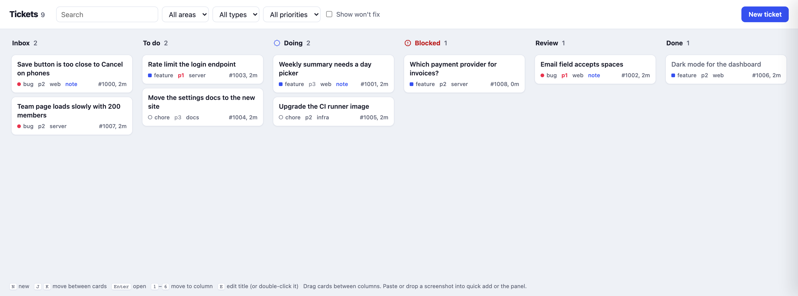
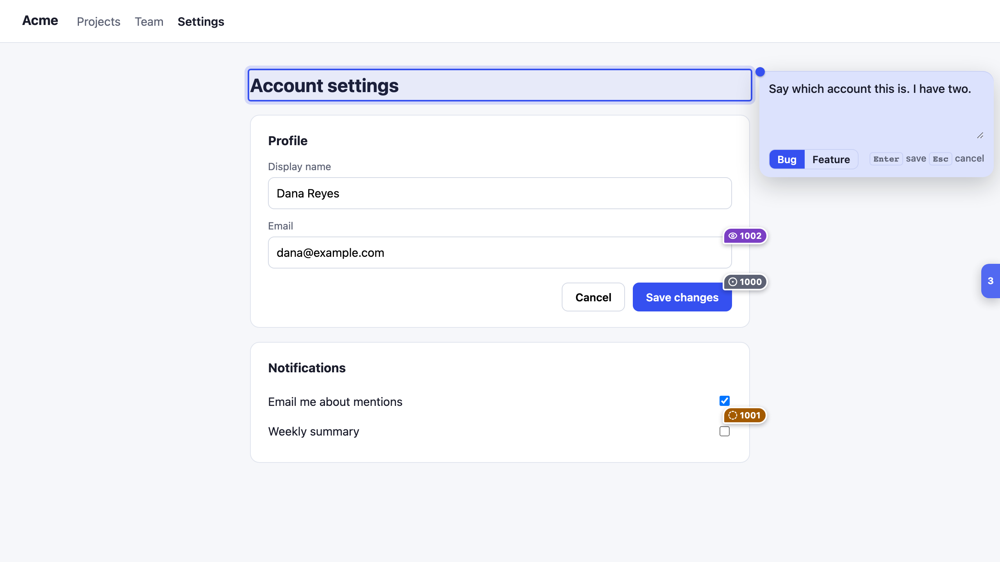
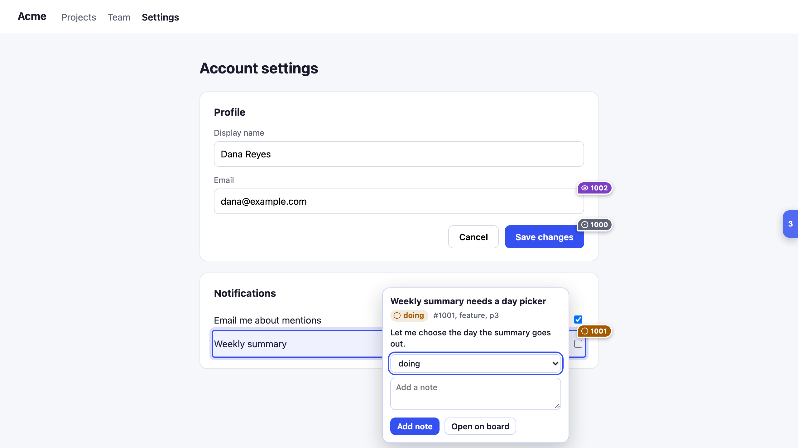

# claudeweaver

Claudeweaver is like Dreamweaver, but with Claude. You point at your running app and say what is wrong. Your coding agent reads the note, does the work and shows you the result for review.

It is an agent skill with three parts:

- A ticket board. It is a kanban page for Markdown ticket files in your repo.
- An overlay for your app in dev mode. You Shift-click (or tap) any element to drop a sticky note. The note becomes a ticket.
- Instructions for the agent. They tell it how to watch the board, how to write tickets and when to move them.







## Install

```sh
npx skills add statico/claudeweaver
```

Then ask your agent to "set up claudeweaver and watch the board". The skill tells the agent how to build the board, add the overlay to your dev server and follow new tickets.

You can also run it from a clone. You need Go 1.22 or later.

```sh
git clone https://github.com/statico/claudeweaver && cd claudeweaver/skills/claudeweaver
go build -o claudeweaver .
mkdir -p ~/myapp/tickets
./claudeweaver -addr :8090 -dir ~/myapp/tickets
```

Open http://localhost:8090. Then add this tag to the dev build of your app only:

```html
<script src="http://localhost:8090/devnotes.js" async onerror="this.remove()"></script>
```

## How it works

### Tickets are Markdown files

Each ticket is one file, for example `tickets/1007-save-button-overlaps-footer.md`. The file has YAML frontmatter (id, title, type, status, priority, area, source, and optionally repo, prs, refs and mcps) and a Markdown body. `repo` is where the work happens, `prs` lists the pull requests the session created, `refs` the ones it referenced and `mcps` the MCP servers it used. The ticket panel shows them as links. You commit the tickets to git with your code. You, the agent and the board all edit the same files. A write by the board changes only the lines it needs and keeps everything else.

A ticket moves through these statuses: `inbox`, `todo`, `doing`, `blocked`, `review`, and then `done` or `wontfix`. The agent sets `doing` when it starts and `review` when it finishes. Only you set `done`.

The agent sets `blocked` when it cannot continue without your decision or review. It writes the question in the ticket and starts other work. You answer in a note, then move the ticket back to `todo` or `doing`.

### The board

The board is one Go program that uses only the standard library. It has no database. The ticket files are the data. The program serves the kanban page, a JSON API and the overlay script. The same binary is also a CLI (`ls`, `show`, `new`, `mv`, `note`, `set`).

On the board, N opens quick add, J and K move between cards, and keys 1 to 6 move a card to a column. You can paste a screenshot into quick add or into the ticket panel. The icon of the Doing column turns, so you can see that work is in progress. The Blocked column is red and has a stop-sign icon.

The notes of a ticket read as a conversation. Your notes are in a shaded box with a `❯` mark, and agent notes have a `●` mark. Notes take Markdown, with ``` code blocks in a monospace font. Cmd+Enter sends a note. Cmd+F searches the notes of the open ticket, and Esc ends the search.

On a wide screen the ticket panel stays docked on the right. Along the bottom of the board is a toolbox with recurring prompts: prompts you write once and run every few days, such as "do the observability checks". Each one shows when it last ran. Run files the prompt as a `todo` ticket, and the agent works it like any other. Each prompt is a Markdown file in `tickets/prompts/`. A polling prompt runs by itself every N minutes: the board wakes the agent, and the agent files tickets only for what it finds, for example one review ticket per new PR link in Slack.

### The overlay

The overlay is one script, `devnotes.js`. It runs in a shadow root, so it does not change the styles of your page.

- Shift-click any element, type the note and press Enter. The ticket stores the URL, a CSS selector, the element text, the viewport and the device: `device` (phone, tablet or desktop), `screen` (for example `402x874@3`), `app` (`tauri-ios`, `tauri-desktop` or `browser`) and `ua` (for example `Safari iOS`).
- On a phone or tablet, open the small tab on the right edge, choose "Drop a note" and tap the element.
- Pins mark the open tickets on the page. Each pin shows the status with a color and an icon. The icon of a `doing` ticket turns. If you set "reduce motion" in your system, the icon does not turn.
- Click a pin to read the ticket, change its status or add a note.
- Paste or drop an image into a note to attach it. You can also turn on screenshots in the menu. On a phone or tablet, tap "Choose from Photos".
- Shift+D hides the whole overlay.

To use the overlay on a phone, serve your app and the board with `tailscale serve`, and start the board with `-tailnet-host <name>.ts.net`. SKILL.md has the steps.

### Send screenshots from an iPhone

You make an iOS Shortcut one time. Then you share a screenshot to it, type a note, and the board gets an `inbox` ticket with the image. The phone must be on your tailnet, and the board must be served with `tailscale serve` (SKILL.md has the steps). Open `https://<name>.ts.net:18090/phone` on the phone to see these steps with your address filled in.

1. Open the Shortcuts app. Tap + to make a new Shortcut. Name it "Send to board".
2. Tap the info button (i) and turn on "Show in Share Sheet". In the first action, set "Receive Images from Share Sheet". If there is no input, set "Stop and Respond".
3. Add the action "Ask for Input". Set the type to Text and the prompt to "Note". Turn on "Allow Multiple Lines" if you want a body.
4. Add the action "Get Contents of URL". Set the URL to `https://<name>.ts.net:18090/api/notes`. Tap "Show More".
5. Set Method to POST and Request Body to Form.
6. Add a Text field. Set the key to `title` and the value to the "Provided Input" variable.
7. Add a File field. Set the key to `image` and the value to the "Shortcut Input" variable.
8. Add the action "Show Notification". Set its text to the "Contents of URL" variable.

To use it, take a screenshot, tap the thumbnail, tap the share button and choose "Send to board". The first line of the note becomes the title, and the other lines become the body. The notification shows the reply, for example `Ticket #1340 created: Button overlaps`.

Each image must be 5 MB or less, and one request takes 10 images at most. If a photo is too large, add the action "Convert Image" (format JPEG) before "Get Contents of URL".

### The JSON API

| Method and path | What it does |
| --- | --- |
| `GET /api/tickets?status=todo,doing&area=web&url=...` | Lists tickets. All filters are optional. |
| `GET /api/tickets/{id}` | Gets one ticket. |
| `POST /api/tickets` | Creates a ticket from JSON. |
| `PATCH /api/tickets/{id}` | Changes fields, for example `{"status":"review"}`. |
| `POST /api/tickets/{id}/notes` | Adds a note, `{"text":"...","by":"name"}`. |
| `POST /api/tickets/{id}/screenshot` | Attaches a PNG, JPEG or WebP image (5 MB maximum). |
| `POST /api/notes` | Creates an `inbox` ticket from a multipart form: `title`, `body` and up to 10 image files. It replies in plain text. |
| `GET /phone` | Shows the iPhone Shortcut steps with the address of this board. |

### The agent loop

Each write through the API prints one line to the output of the board, for example `EVENT created #1012 bug web p2 "Title"`. The agent writes this output to a log file and watches the log in the background. When a line comes in, the agent wakes up, reads the ticket, sets `doing`, does the work, writes a `## Resolution` section and sets `review`. Then you look at the result and close the ticket.

[skills/claudeweaver/SKILL.md](skills/claudeweaver/SKILL.md) has the full instructions for the agent: the flags, the CLI, the ticket format, how to write tickets and the watch loop.

## Security

Claudeweaver is a tool for development only. Do not run it on a server, and do not load the overlay in production.

- The board listens on loopback (`127.0.0.1` and `::1`) only. To listen on another address, you must set `-unsafe-listen-any`.
- There is no auth. Each program on your machine can read and change the tickets.
- The board refuses requests whose `Host` header is not a loopback name. This stops DNS rebinding.
- The API accepts browser requests only from `http://localhost`, `http://127.0.0.1` and `http://*.localhost` pages. With `-tailnet-host`, it also accepts that one Tailscale name over HTTPS.
- A request without an `Origin` header (the CLI, curl, an iOS Shortcut) is not a browser page, so the API accepts it. It must still pass the `Host` check.

## Tests

```sh
cd skills/claudeweaver && go vet ./... && go test -race -count=1 ./...
```

## License

MIT. See [LICENSE](LICENSE).
